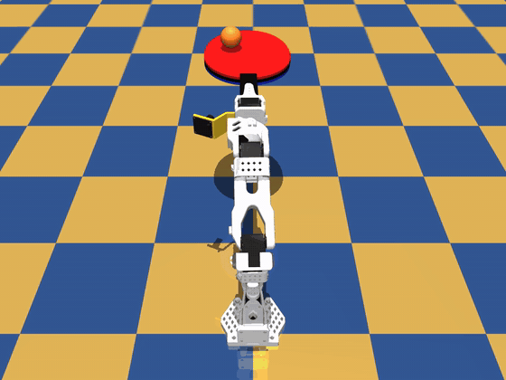

# SO-101 ping-pong ball balancing

A low-cost [SO-101](https://github.com/TheRobotStudio/SO-ARM100) arm balances a ping-pong ball on a table-tennis paddle. **The wrist camera is its
only sensor for the ball**; the rest is the arm's own joint readings. The controller is trained with PPO in MuJoCo and runs unchanged on the real arm.



*The trained controller in simulation, with two gentle kicks to the ball.* Real arm: [video on X](https://x.com/zecicc/status/2118380170662863229).

**Results:** 97.5% of episodes balanced for 10 s in randomized sim (latency 0–4 frames, soft servos, noisy ball state); 113/120 in sim with
the full camera pipeline; balances on the real arm.

## How it works

```
wrist camera (640x480 -> 128x96)
  -> detector     orange-blob colour threshold: x, y, radius, visible            perception/detector.py
  -> estimator    MLP on the last 3 detections -> ball position on the paddle    perception/estimator.py  (trained in sim)
  -> FdVel        velocity = filtered finite differences of the positions        sim/env.py
  -> controller   PPO MLP -> 5 joint-position deltas, 30 Hz                      sim/ppo.py, sim/train_controller.py
```

The paddle is clamped edge-on to the wrist camera, so the camera sees it from the side and the ball near one image column.

What made sim-to-real work: **train the controller with the real system's flaws from the start**.
- Control latency randomized over 0–4 frames (0–133 ms), with the last 3 actions in the observation.
- Soft, randomized servo gains (cheap servos sag and lag).
- The ball state the controller sees is noisy like the estimator's output, and its velocity comes from the **same finite-difference filter** the
  robot uses. A controller trained on exact velocity failed completely on camera-derived velocity.

What did **not** work: an end-to-end CNN policy on wrist images (behaviour cloning + DAgger from the PPO controller). It was fine in sim but
barely saw the real ball. A plain colour detector + a tiny estimator replaced it.

## Install

```bash
git clone https://github.com/zecice/so101-pingpong-balance && cd so101-pingpong-balance
uv sync                      # sim only
uv sync --extra hardware     # + LeRobot / Feetech drivers for the real arm
```
Uses [uv](https://docs.astral.sh/uv/); `uv sync` installs the exact tested versions from `uv.lock` (pip install is not set up).
Run everything from the repo root. Developed on Linux (laptop, CPU only, 16 GB RAM); the code avoids Linux-only calls, but macOS and
Windows are untested. On macOS the live viewer must be started with `mjpython` instead of `python`.
Training needs ~5 GB of free RAM by default; see the note under training if you have less.

## Try it in sim (no arm needed)

```bash
uv run python -m sim.view_controller --rand                    # live viewer, pretrained controller
uv run python -m sim.eval_policy --episodes 40                 # controller success per latency (true ball state)
uv run python -m perception.estimator --eval weights/estimator.pt --latency 0,2,4 --workers 4 --servo-rand --episodes 40
                                                               # full camera pipeline in sim
```

### Train the controller (~29M steps, ~2 h on 6 CPU cores)

Default: 6 workers x 4 envs = 24 parallel sims x 128 steps = 3072 samples per iteration.
- Fewer CPU cores: keep the 24 envs on fewer workers (`--workers 3 --envs-per-worker 8`).
- Less RAM: use fewer envs and more steps, to keep the batch size (`--workers 3 --envs-per-worker 4 --steps 256`, ~2.5 GB).

Only the default settings were used for the released weights.

```bash
uv run python -m sim.train_controller --name my_controller --iters 9500 --act-hist 3 --grip-rot -90 --max-latency 4 --home-penalty 0.1 --servo-rand --ball-noise 1.0
```
Add `--wandb` for logging (after `uv sync --extra wandb`, plus `--extra hardware` if you also use the arm). `weights/controller.pt` is the best checkpoint of a run with this command.

### Train the estimator

```bash
uv run python -m perception.estimator --name my_estimator --frames 500000
```
Collects 500k frames of simulated wrist-camera detections while the controller balances with heavy action noise, then trains. The shipped
`weights/estimator.pt` was trained the same way with an earlier controller.

## Real arm

Hardware: SO-101 follower, wrist camera, a standard paddle clamped in the gripper, edge-on to the camera, an orange ball.

**Safety:** the arm moves on its own and stays powered after the scripts exit. Keep clear of it and be ready to press Ctrl+C. To release it, hold the arm and run `hardware.torque_off`.

```bash
uv run lerobot-calibrate --robot.type=so101_follower --robot.port=/dev/ttyACM0 --robot.id=my_follower_arm   # once, if not calibrated yet
uv run python -m hardware.run_real --grip-only   # type o: the arm lifts, the gripper opens, hold the paddle in the jaws, Enter -> it squeezes
uv run python -m hardware.pose_guide      # once: hold the arm, it goes limp; level the paddle, Ctrl+C -> hardware/home.json
uv run python -m hardware.run_real        # Enter keeps the paddle (o inserts it) -> it goes home, waits for the ball
uv run python -m hardware.torque_off      # arm goes limp (hold it!)
```
If your arm is already calibrated under another name, pass `--id <name>` to the hardware scripts.
The home pose depends on each arm's calibration, so everyone makes their own (`hardware/home_example.json` is mine, for the format).
`--port` defaults to `/dev/ttyACM0` (macOS: `/dev/tty.usbmodem...`, Windows: `COM3` etc.; `lerobot-find-port` tells you).
`--cam` defaults to `/dev/video4`; a camera index like `--cam 0` works on every OS.

Things that mattered on the real arm:
- **Servo P gain 32**, not LeRobot's default 16: at 16 the arm sags and ignores 4–7° commands. `run_real.py` sets it.
- **Level home pose.** A few degrees of tilt and the ball runs off: the policy has no integral action.
- **Gripper:** squeeze by load (~10%), never command "fully closed" on the paddle. A stall trips the Feetech overload protection and the
  motor drops off the bus until a power cycle.
- Measure your own latency with `uv run python -m hardware.measure_latency PORT CAMERA` (after `--grip-only`, paddle in): the controller is trained for 0-4 extra 33 ms steps.

## Layout

| Folder | |
|---|---|
| `sim/` | MuJoCo env, parallel envs, PPO, training, eval, viewer |
| `perception/` | ball detector + estimator (trained in sim, used in sim and on the arm) |
| `hardware/` | real-arm loop and utilities (LeRobot `SOFollower`) |
| `assets/so101/` | arm + paddle + scene MJCF and meshes (see its README for sources and licenses) |
| `weights/` | pretrained controller and estimator |

## License

Code and weights: MIT. SO-101 model files: Apache-2.0 (TheRobotStudio). Paddle mesh: MIT. See `assets/so101/README.md`.
